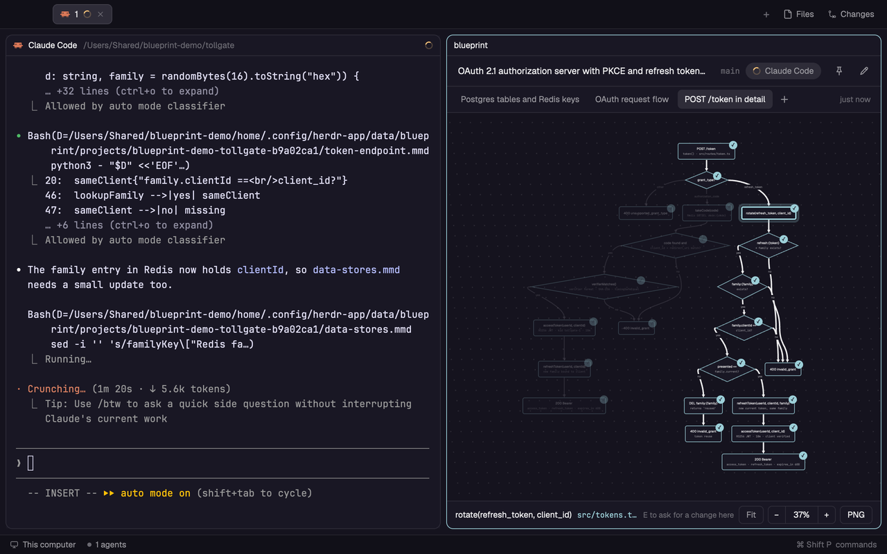

# Blueprint for Herdr

Blueprint는 코딩 에이전트가 지금 만들고 있는 코드를 바로 옆에 다이어그램으로 보여 주는 [Herdr](https://herdr.dev) 앱 mod입니다. 에이전트(Claude Code, Codex, Grok 등)가 Mermaid flowchart를 Blueprint 데이터 폴더에 저장하면, Blueprint가 배치해서 그리고 끝난 부분과 작업 중인 부분을 표시합니다. 박스를 골라 수정 요청을 쓰면 그 에이전트에게 바로 갑니다.



## 설치

Herdr 안에서 에이전트를 띄우고 이렇게 부탁하면 됩니다.

```
https://github.com/chappse6/herdr-blueprint-app 에 있는 Herdr mod를 추가해 줘
```

에이전트는 Herdr의 `AGENTS.md`에 적힌 순서대로 `mods/blueprint`를 Herdr 앱 폴더에 복사하고 `herdr-app check`를 돌립니다. 직접 하려면 `mods/blueprint`를 앱 폴더의 `mods` 아래(macOS는 `~/.config/herdr-app/mods/`)에 복사하고 `herdr-app check ~/.config/herdr-app/mods/blueprint`를 실행하세요.

Blueprint는 자기 폴더 밖의 파일을 읽고 프로그램을 실행합니다. 터미널이 어느 프로젝트인지 찾으려고 `git rev-parse`를, 에이전트에게 요청을 입력하려고 `hc send`를 씁니다. macOS에서 PNG를 만들 때는 `sips`와 `osascript`도 씁니다. Claude Code 언어 설정을 따르려고 `~/.claude/settings.json`을 읽고, 네트워크는 쓰지 않습니다.

## 열기

Herdr 안의 아무 터미널에서:

```
herdr-app do pane.split --direction right --mod blueprint
```

지금 포커스된 pane 오른쪽에 Blueprint pane이 열리고, 그 탭의 에이전트를 따라갑니다.

탭바의 Files, Changes 옆에 버튼을 두고 싶으면 Blueprint pane이 열린 상태에서 한 번 실행하세요.

```
herdr-app do blueprint.add-button
```

Herdr의 `main` 레이아웃과 `tabs` mod를 `main-blueprint`, `tabs-blueprint`로 복제해서 버튼을 넣고 그 레이아웃으로 바꿉니다. 레이아웃 전환은 `ctrl-shift-l`이고, `herdr-app do blueprint.remove-button`을 실행하면 원래 쓰던 레이아웃으로 돌아가면서 복제본을 지웁니다. Herdr 업데이트로 탭바가 바뀌면 remove-button 다음에 add-button을 다시 실행하면 됩니다.

## 쓰는 법

처음 열면 그 탭에 있는 에이전트 목록이 나옵니다. 하나를 고르면 Blueprint가 그 에이전트에게 지금 작업 중인 코드를 그리고 계속 갱신해 달라고 요청합니다. 파일이 저장되는 순간 화면에 나타납니다.

- 박스를 누르면 연결된 흐름 전체가 강조됩니다. 드래그로 이동하고, ⌘ 또는 Ctrl을 누른 채 스크롤하면 확대, `F`를 누르면 화면에 맞춥니다.
- 박스를 고르고 `E`를 누르면 그 박스에 대한 수정 요청을 바로 쓸 수 있습니다. 박스 이름, 소스에서의 위치, 연결된 코드 경로가 함께 에이전트에게 갑니다.
- 탭 옆의 `+`로 데이터 구조나 특정 기능 상세 같은 다이어그램을 더 요청할 수 있습니다.
- 에이전트가 끝냈다고 표시한 박스에는 체크가, 작업 중인 부분은 노란색이 붙습니다. pane에 포커스가 있을 때만 작업 중인 경로를 따라 점이 움직입니다(갈래마다 하나).
- 핀을 누르면 그 다이어그램을 계속 보관합니다. 고정하지 않은 다이어그램은 마지막으로 본 뒤 7일이 지나면 지워지고, 하루 넘은 것은 프로젝트당 10개까지만 남습니다.

화면 언어는 Claude Code의 `language` 설정을 따라 영어, 한국어, 일본어 중에서 정해집니다.

## 다이어그램이 저장되는 곳

저장소 안에는 아무것도 만들지 않습니다. 프로젝트마다 Herdr 앱 폴더의 `data/blueprint/projects/<이름>-<해시>/` 폴더가 생기고, 다이어그램 하나가 `.mmd` 파일 하나입니다. 핀과 연결한 에이전트는 `project.json`에 적힙니다. 프로젝트는 터미널 폴더의 git 최상위 폴더 기준이라 worktree마다 따로 관리됩니다.

## 지원 환경

macOS, Linux, Windows에서 돌도록 만들었습니다. 셸, Python, Node 없이 동작하고 탭바 버튼도 mod가 직접 설치합니다. 실제로 돌려 본 환경은 macOS(Herdr 0.1.10)뿐이고 Windows와 Linux는 아직 확인하지 못했습니다. PNG 내보내기는 지금은 macOS에서만 되고, 다른 OS에서는 버튼이 보이지 않습니다.

## 개발

`scripts/sync.sh`는 `mods/blueprint`를 Herdr 앱 폴더로 복사합니다. 심볼릭 링크로 연결한 mod는 Herdr가 다시 읽지 않아서 복사합니다. `scripts/sync.sh --watch`는 파일이 바뀔 때마다 다시 복사합니다. 에이전트가 처음부터 다시 만들 때 쓸 설명은 `RECIPE.md`에 있습니다.

## 라이선스

MIT
