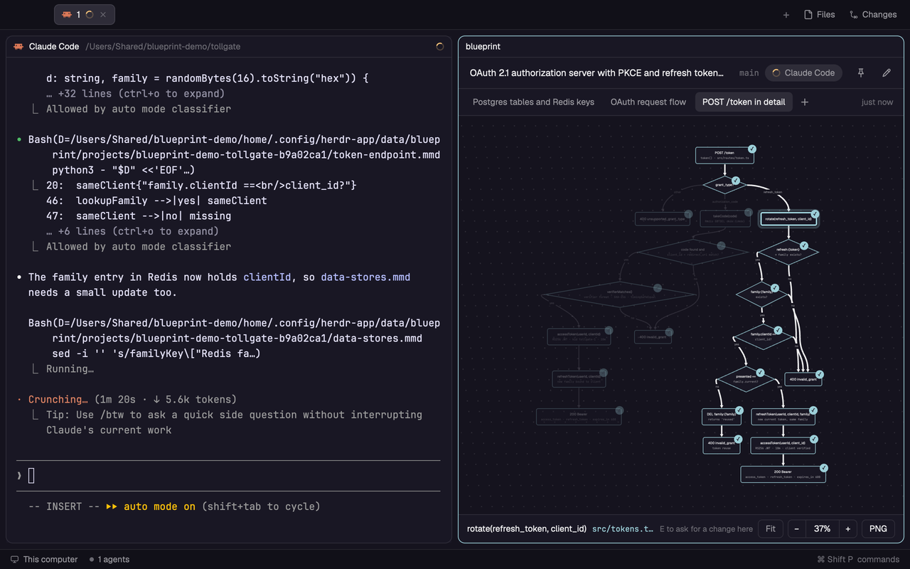

# Blueprint for Herdr

Blueprint is a [Herdr](https://herdr.dev) app mod that shows what your coding agent is building as a diagram, right next to it. The agent (Claude Code, Codex, Grok and others) writes a Mermaid flowchart into Blueprint's own data folder. Blueprint lays it out, marks the parts that are done and the parts in progress, and sends your change requests back to that agent.



[한국어 README](README.ko.md)

## Install

Run an agent inside Herdr and ask it:

```
Add the Herdr mod from https://github.com/chappse6/herdr-blueprint-app
```

Herdr's own `AGENTS.md` tells the agent what to do: copy `mods/blueprint` into your Herdr app folder and run `herdr-app check`. To do it by hand, copy `mods/blueprint` into the `mods` folder there (`~/.config/herdr-app/mods/` on macOS) and run `herdr-app check ~/.config/herdr-app/mods/blueprint`.

Blueprint runs programs and reads files outside its own folder, which Herdr asks agents to point out before adding a mod. It runs `git rev-parse` to find the project of a terminal, `hc send` to type requests into your agent, and `sips` and `osascript` for PNG export on macOS. It reads `~/.claude/settings.json` to follow Claude Code's language. It doesn't use the network.

## Open it

From any terminal in Herdr:

```
herdr-app do pane.split --direction right --mod blueprint
```

That opens Blueprint as a pane beside the focused one. It serves the tab it was opened in.

For a button in the tab bar next to Files and Changes, run this once while a Blueprint pane is open:

```
herdr-app do blueprint.add-button
```

It clones Herdr's `main` layout and `tabs` mod as `main-blueprint` and `tabs-blueprint`, adds the button and switches to that layout. `ctrl-shift-l` switches layouts, and `herdr-app do blueprint.remove-button` goes back to the layout you used before and deletes the clones. After a Herdr update changes the tab bar, run remove-button and then add-button again.

## Use

The first time, Blueprint lists the agents in the tab. Pick one and Blueprint asks it to draw what it is working on and keep the drawing up to date. The diagram appears as soon as the file is saved.

- Click a box to light up its whole flow. Drag to move, ⌘ or Ctrl + scroll to zoom, `F` to fit.
- Pick a box and press `E` to write a change request for it. It goes to the agent with the box, its place in the source and the code it stands for.
- `+` next to the tabs asks the agent for another diagram, such as the data model or one feature in detail.
- Boxes the agent marked done get a check; work in progress is yellow. While the pane has focus, a dot runs along the work in progress.
- The pin keeps a diagram. Unpinned ones are deleted 7 days after you last looked at them, and a project keeps at most 10 that are older than a day.

The interface is in English, Korean or Japanese, following the `language` setting of Claude Code.

## Where diagrams live

Not in your repositories. Each project gets a folder under Herdr's app folder, `data/blueprint/projects/<name>-<hash>/`, with one `.mmd` file per diagram and a `project.json` for pins and the connected agent. A project is the git top level of the terminal's folder, so each worktree is its own project.

## Platforms

Blueprint is written for macOS, Linux and Windows: it needs no shell, Python or Node, and the tab bar button is installed by the mod itself. It has been run on macOS (Herdr 0.1.10). Windows and Linux are not tested yet. PNG export is macOS only for now; the button is hidden elsewhere.

## Develop

`scripts/sync.sh` copies `mods/blueprint` into the Herdr app folder (Herdr doesn't reload a symlinked mod), and `scripts/sync.sh --watch` copies again on every change. `RECIPE.md` describes the mod for an agent that wants to build it from scratch.

## License

MIT
