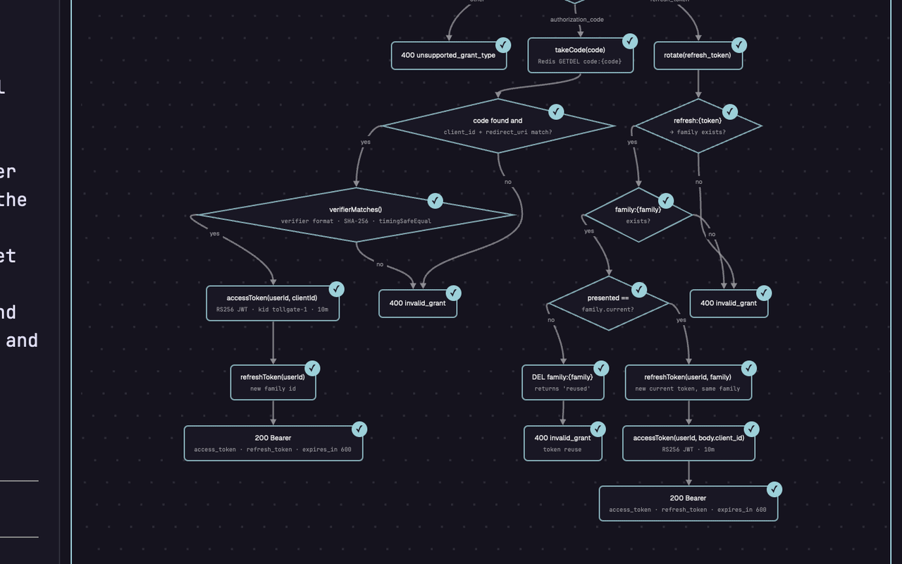
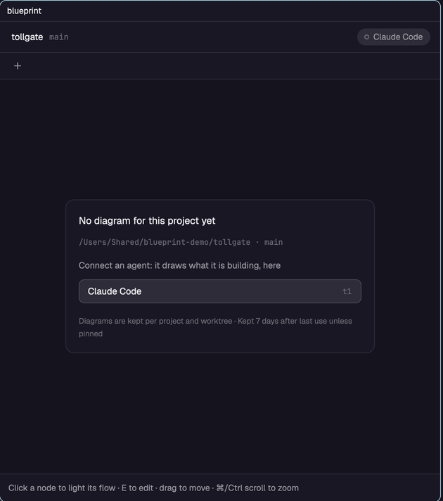
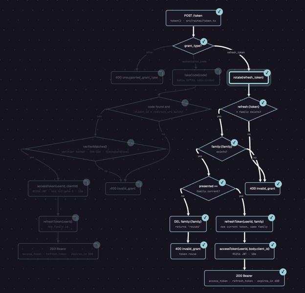
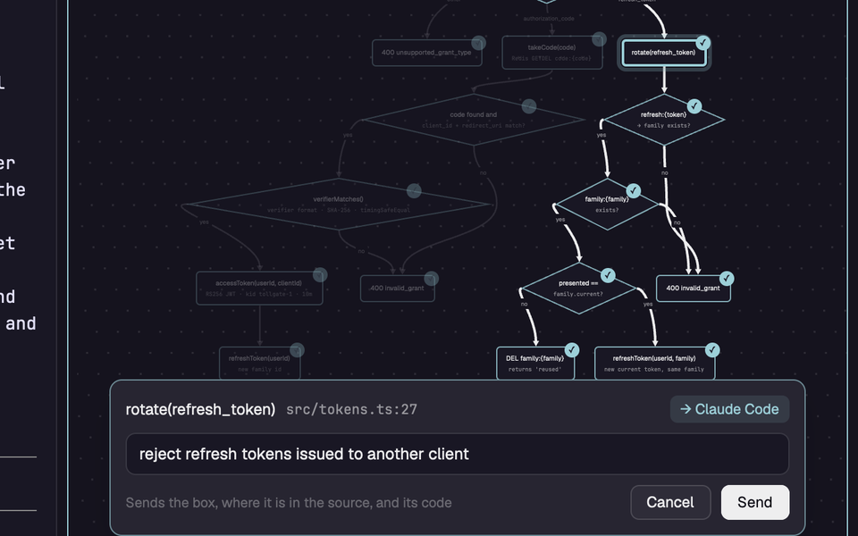
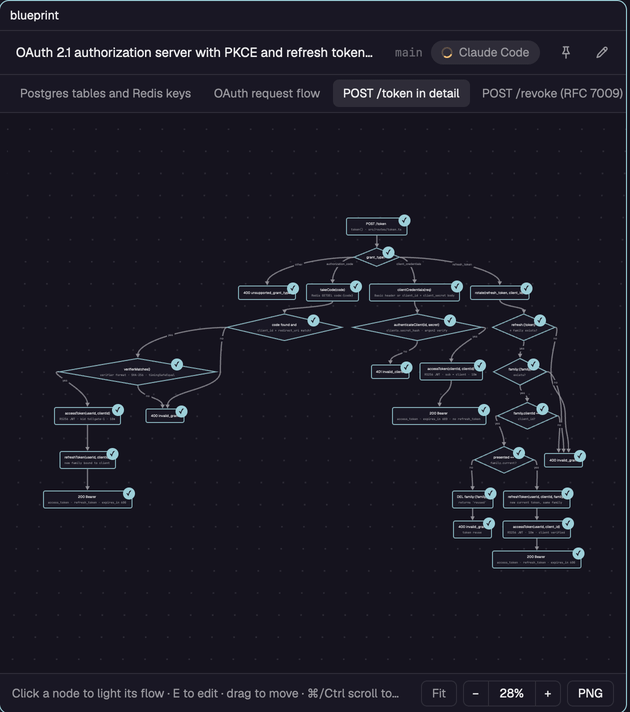
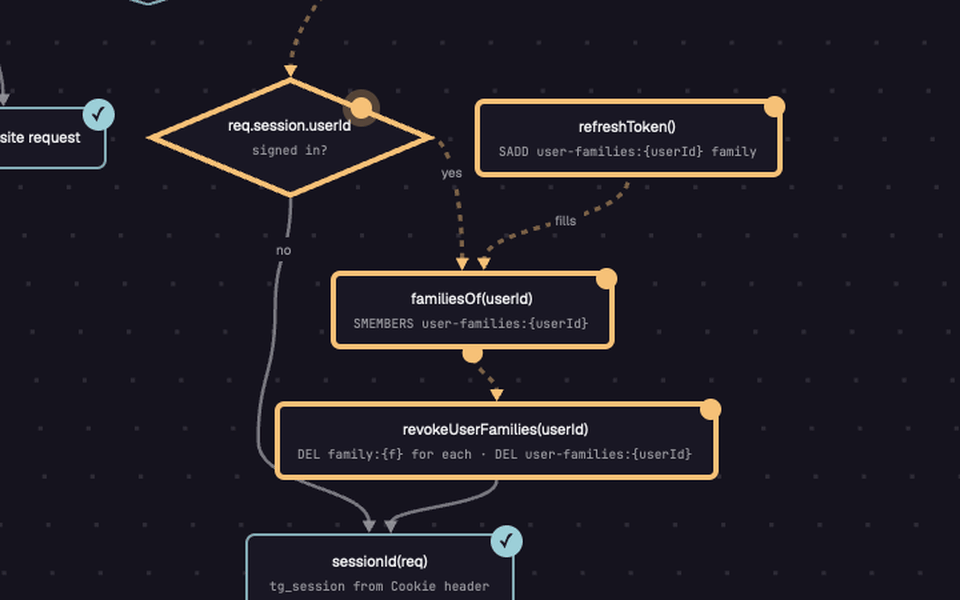
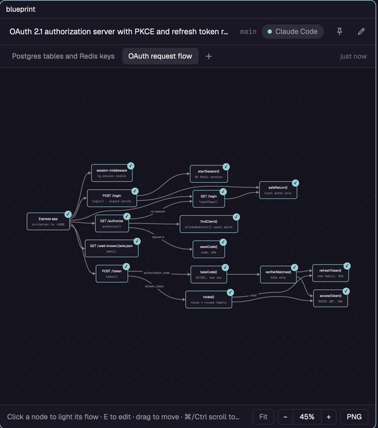
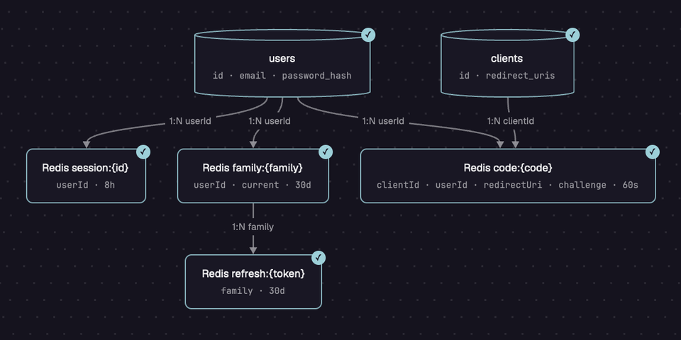
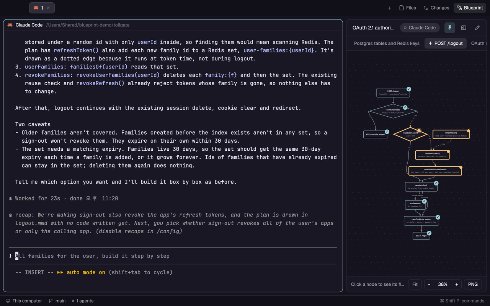

<h1 align="center">Blueprint for Herdr</h1>

<p align="center"><b>See what your coding agent is building, as a diagram, right next to it.</b></p>

<p align="center">
  
  
  
</p>

<p align="center">
  
  <br>
  <sub>Point at a box and ask. Claude Code changed the code behind it, and Blueprint drew the new check. (<a href="docs/media/point-and-ask.mp4">MP4</a>)</sub>
</p>

[한국어 README](README.ko.md)

Blueprint is a mod for the [Herdr](https://herdr.dev) desktop app. Your agent draws the code it is building as a Mermaid flowchart, and Blueprint shows it beside the chat while the work goes on.

- **The code at a glance.** Boxes are pieces of your code, tied to their file and line. Finished parts get a check and the part being built is yellow, so you see where the agent is without reading the chat.
- **Ask where you look.** Pick a box, press `E` and write what should change. The agent gets the box, its place in the code and your note.
- **Kept out of your repo.** Diagrams live in Herdr's app folder, one set per project and worktree, and the ones nobody looks at go away after 7 days unless you pin them.

## Install

Run an agent inside Herdr and ask it:

```
Add the Herdr mod from https://github.com/chappse6/herdr-blueprint-app
```

Herdr's `AGENTS.md` tells the agent what to do: copy `mods/blueprint` into your Herdr app folder and check it. By hand, copy `mods/blueprint` into the `mods` folder there (`~/.config/herdr-app/mods/` on macOS) and run `herdr-app check ~/.config/herdr-app/mods/blueprint`.

Then open it beside your agent, from any terminal in Herdr:

```
herdr-app do pane.split --direction right --mod blueprint
```

## A tour

### 1. Connect your agent

The first time, Blueprint lists the agents in the tab. Pick one and Blueprint asks it to draw the code it is working on, in a folder of Blueprint's own. The diagram shows up as soon as the file is saved.

<p align="center"></p>

### 2. Follow a flow

Click a box and everything upstream and downstream of it stays lit; the rest fades. Drag to move, ⌘ or Ctrl + scroll to zoom, `F` to fit.

<p align="center"></p>

### 3. Point at a box and ask

With a box picked, press `E` and write the change. Blueprint types it into the agent's terminal with the box, its line in the source, the code path it stands for and the whole diagram, and asks the agent to update the drawing when it is done.

<p align="center"></p>

### 4. Watch the work move

The agent marks what it is building `active` and what it is on right now `current`. Those boxes turn yellow, and while the pane has focus a dot runs along the yellow edges. When the agent starts a new diagram for a feature, Blueprint switches to it.

<p align="center">
  
  
</p>

### 5. Ask for another diagram

`+` next to the tabs asks the agent for a new diagram: the data model, one endpoint in detail, the whole project. It opens as a tab when it arrives.

<p align="center"></p>

### 6. Only what the code has

Agents are told to draw only what exists. Here Claude Code drew the two real Postgres tables as cylinders and the Redis keys as plain boxes, with the relations on the edges. In a project with no database it says so and draws what plays that part under its real name.

<p align="center"></p>

### 7. In the tab bar

`herdr-app do blueprint.add-button`, run once with a Blueprint pane open, puts a Blueprint button next to Files and Changes. It opens Blueprint as a side panel that follows the tab you are on. Pin a diagram to keep it past 7 days. `herdr-app do blueprint.remove-button` takes the button away and returns to the layout you had.

<p align="center"></p>

## Good to know

- **Agents.** Claude Code, Codex, Grok, Gemini, OpenCode and other agents Herdr knows. Requests are typed into their terminal with `hc send`.
- **Language.** English, Korean or Japanese, following the `language` setting of Claude Code.
- **Where diagrams live.** `data/blueprint/projects/<name>-<hash>/` in Herdr's app folder: one `.mmd` file per diagram and a `project.json` for pins and the connected agent. A project is the git top level of the terminal's folder, so every worktree is its own.
- **What it runs.** `git rev-parse` to find the project, `hc send` to reach the agent, and `sips` and `osascript` for PNG export on macOS. It reads `~/.claude/settings.json` for the language. No network.
- **Platforms.** Written for macOS, Linux and Windows with no shell, Python or Node. It has been run on macOS (Herdr 0.1.10); Windows and Linux are not tested yet. PNG export is macOS only.

## Develop

`scripts/sync.sh` copies `mods/blueprint` into the Herdr app folder (Herdr doesn't reload a symlinked mod), and `--watch` copies on every change. `scripts/demo/` rebuilds the pictures on this page from a real session in a Herdr window of its own: `start.sh`, then `record.py` while you drive it, then `make.py clips.json`. `RECIPE.md` describes the mod for an agent that wants to build it from scratch.

## License

MIT
